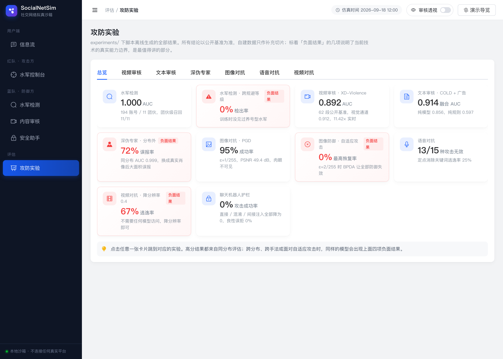

# SocialNetSim · 社交网络拟真沙箱

> **《应用综合实验》课程项目 —— 多模态信息处理方向：社交网络拟真开发**

一个完全在本地运行的仿真社交平台。实现了水军账号模拟与检测、(长/短)视频内容解析与不良内容监测，
并在此基础上完成文本 / 图像 / 视频 / 语音四个模态的 AI 安全对抗攻防，以及基于 AI 安全的智能聊天机器人。

所有功能只操作本机的 SQLite 数据库，**不接触任何真实社交平台**，不使用任何真实违规素材。


---

## 目录

- [一、这个项目做了什么](#一这个项目做了什么)
- [二、在你的电脑上跑起来](#二在你的电脑上跑起来) ← **组员从这里开始**
- [三、界面有什么](#三界面有什么)
- [四、主要实验结果](#四主要实验结果)
- [五、复现实验](#五复现实验)
- [六、代码结构](#六代码结构)
- [七、数据集与模型](#七数据集与模型)
- [八、常见问题](#八常见问题)

---

## 一、这个项目做了什么

对照实验要求逐条实现：

| 实验要求 | 本项目实现 | 代码位置 |
|---|---|---|
| **基本功能**<br>实现基本水军账号的功能 | 5 种水军策略（控评刷量 / 抹黑 / 话题带节奏 / 互粉抱团 / 广告引流）× 3 级规避强度，生成带真值标签的协同行为；配套 41 维五组特征的检测系统 | [bot_engine.py](socialsim/simulation/bot_engine.py)<br>[bot_detector.py](socialsim/simulation/bot_detector.py) |
| **基本功能**<br>(长/短)视频内容解析，不良内容监测 | 快慢双通道关键帧选择 + 帧级多专家 + 语音理解 + OCR + 时序聚合 + 可视化报告 | [video_pipeline.py](socialsim/moderation/video_pipeline.py) |
| **扩展**<br>结合 AI Security 的对抗实例 | 文本混淆攻击、图像 FGSM/PGD/SPSA/BPDA、视频时序稀疏攻击、语音端到端逃逸攻击 | [security/attacks/](socialsim/security/attacks/) |
| **扩展**<br>对文本、图片、视频的攻击及防御 | 归一化防御、输入变换、随机化集成、特征压缩检测、**自适应攻击评估** | [security/defenses/](socialsim/security/defenses/) |
| **扩展**<br>对声音的攻击及防御 | 攻击审核流水线的语音识别环节，15 种攻击 × 5 种防御，按端到端审核逃逸计成功率 | [audio_attack.py](socialsim/security/attacks/audio_attack.py) |
| **扩展**<br>基于 AI 安全的智能聊天机器人 | 四层纵深护栏（输入检测 / 注入识别 / Spotlighting 隔离 / 输出守卫），含间接提示注入防御 | [guard.py](socialsim/security/guard.py)<br>[chatbot.py](socialsim/security/chatbot.py) |

完整的实验分析见 **[实验报告](docs/实验报告.md)**，动手前的前沿调研见 [视频检测调研](docs/调研_视频检测与不良内容监测前沿.md) 与 [社交仿真调研](docs/调研_社交网络拟真与水军检测前沿.md)。

---

## 二、在你的电脑上跑起来

### 2.1 先确认三件事

| 需要 | 怎么装 |
|---|---|
| **Python 3.10–3.12** | macOS：`brew install python@3.11`<br>Ubuntu：`sudo apt install python3.11 python3.11-venv`<br>Windows：到 python.org 下载安装，勾选 Add to PATH |
| **ffmpeg**（视频解码必需） | macOS：`brew install ffmpeg`<br>Ubuntu：`sudo apt install ffmpeg`<br>Windows：`winget install ffmpeg` |
| **约 4 GB 磁盘空间** | 依赖 1.2G + 模型 1.5G + 数据 1.3G |

检查是否装好：

```bash
python3 --version && ffmpeg -version | head -1
```

> **Windows 用户注意**：项目在 macOS / Linux 上验证过。Windows 建议用 WSL2（先 `wsl --install`，再在 Ubuntu 里操作）。
> 原生 Windows 下 `setup.sh` 需要 Git Bash，且合成测试视频的语音会缺失，见第八节。

### 2.2 三条命令

```bash
git clone https://github.com/F1sher-2578/SocialNetSim.git
cd SocialNetSim
bash setup.sh
```

`setup.sh` 会自动完成 7 步，**全程约 15–30 分钟**，主要时间花在下载上：

| 步骤 | 内容 | 耗时 |
|---|---|---|
| 0 | 检查 Python / ffmpeg / 磁盘空间，缺什么会直接告诉你怎么装 | 秒级 |
| 1–2 | 建虚拟环境、装依赖（走清华镜像） | 2–5 分钟 |
| 3 | 下载 8 个预训练模型（走 hf-mirror 镜像，**不需要科学上网**） | 5–10 分钟 |
| 4 | 下载数据集：XD-Violence 视频、COLD 中文语料、真假人脸、CIFAR-10 | 5–15 分钟 |
| 5 | 初始化沙箱：生成 80 个正常用户的 30 天行为 + 11 个水军团伙 | 1 分钟 |
| 6 | 阈值校准：在正常素材上估计各专家的分数分布 | 3 分钟 |
| 7 | 自检：逐项验证文本审核、语音后端、安全护栏、信息流 | 秒级 |

看到 `全部通过` 就说明装好了。中途断了直接重跑 `bash setup.sh`，已完成的步骤会自动跳过。

### 2.3 启动

```bash
./run_server.sh
```

浏览器打开 **http://127.0.0.1:8000**，按 `Ctrl+C` 停止。

### 2.4 进去先玩这几个

| 想看什么 | 怎么做 |
|---|---|
| 审核能不能抓到违规 | 信息流页 → 发布框输入 `加 微 信 xk8899 领取内部优惠` → 发布并审核 |
| 水军怎么被识别出来 | 水军检测页 → 点「重新提取特征并评估」→ 等约 10 秒 → 看消融与泛化表格 → 点任意账号看判定依据 |
| 自己造一批水军 | 水军控制台 → 选策略和规避等级 → 执行 → 回水军检测页重新评估，看检出率变化 |
| 视频审核长什么样 | 内容审核页 → 上传任意视频 → 等几十秒 → 点「查看完整可视化报告」 |
| 提示注入攻防对比 | 安全助手页 → 点左侧攻击样例填入 → 分别在「启用安全护栏」勾选与不勾选下发送，对比结果 |
| 所有实验数据 | 攻防实验页 → 刷新 |

---

## 三、界面有什么

六个页面。

**水军检测** —— 特征组消融、跨团伙泛化、逐账号判定依据


**安全助手** —— 可开关护栏做 A/B 对照，左侧提供攻击与良性样例


**攻防实验** —— 汇总所有离线实验结果



---

## 四、主要实验结果

| 模块 | 数据 | 结果 |
|---|---|---|
| 水军检测 | 194 账号 / 11 团伙 | AUC 1.000，Recall@FPR=1% 为 1.000，团伙级召回 11/11 |
| **水军检测泛化** | 跨规避等级 | 训练时没见过养号型水军时，检出率 **0.000** |
| 无监督协同发现 | 不用标签 | 5 个社区，纯度 100%，覆盖 17.5% 水军 |
| 视频审核 | XD-Violence 62 段 | 整体 AUC 0.892，视觉通道 0.912，约 11 倍实时 |
| 视频审核 | 自建中文切片 8 段 | AUC 1.000 |
| 文本审核 | COLD + 广告切片 1712 条 | 融合 AUC 0.914（纯模型 0.856，纯规则 0.597）|
| **深伪专家** | 500 张同分布 / 25 张分布外 | AUC 0.999 vs 分布外真实照片误报率 **72%** |
| 图像对抗 | 20 张伪造样本 | PGD 在 ε=1/255（PSNR 49dB，肉眼不可见）下成功率 95% |
| **图像防御** | BPDA 自适应攻击 | ε≥2/255 时全部防御恢复率归零 |
| 语音对抗 | 15 种攻击 | 无差别攻击 11/13 失效；定点消除关键词逃逸率 25% |
| 视频对抗 | 5 种攻击 | 降分辨率至 0.4 倍逃逸率 67%（零模型访问成本）|
| 聊天机器人护栏 | 直接/混淆/间接注入 | 攻击成功率全部降到 0，良性误拒率 0 |

加粗的四项是负面结果，也是报告里最值得讲的部分：它们说明了当前技术的真实能力边界。详见 [实验报告](docs/实验报告.md)。

---

## 五、复现实验

仓库里 `results/*.json` 和 `docs/figures/*.png` 已经是跑完的结果，**不跑也能直接看**。

想自己重跑：

```bash
./run_all_experiments.sh
```

全部跑完约 60–90 分钟。或单独跑某一项：

```bash
.venv/bin/python experiments/exp_bot_detection.py     # 水军检测：消融 + 泛化 + 无监督协同
.venv/bin/python scripts_calibrate.py                 # 阈值校准（换数据后必须重跑）
.venv/bin/python experiments/exp_text_bench2.py       # 文本审核基准
.venv/bin/python experiments/exp_prompt_tuning.py     # 提示集与聚合方式网格搜索
.venv/bin/python experiments/exp_video_bench.py       # 视频审核基准（最慢，约 12 分钟）
.venv/bin/python experiments/exp_deepfake_eval.py     # 深伪专家评估
.venv/bin/python experiments/exp_adv_audio.py         # 语音对抗攻防
.venv/bin/python experiments/exp_adv_video.py         # 视频对抗攻防
.venv/bin/python experiments/exp_chatbot_guard.py     # 聊天机器人护栏
.venv/bin/python experiments/make_figures.py          # 重新生成全部图表
```

图像对抗建议走 CPU，否则会和其他实验抢 MPS：

```bash
SOCIALSIM_DEVICE=cpu .venv/bin/python experiments/exp_adv_image.py
```

结果写进 `results/*.json`，图表写进 `docs/figures/`。

---

## 六、代码结构

```
SocialNetSim/
├── socialsim/
│   ├── config.py                 全局配置：路径、模型 id、阈值、设备选择
│   ├── db.py / models.py         SQLite ORM：用户/帖子/评论/点赞/关注/行为日志/审核记录
│   │
│   ├── simulation/               —— 仿真层
│   │   ├── personas.py           人设生成（正常用户 / 水军 / 伪装水军）
│   │   ├── content_gen.py        内容生成（正常模板 / 水军模板 / 变体改写）
│   │   ├── seed.py               30 天基线行为（昼夜节律 + 热度偏好）
│   │   ├── bot_engine.py         水军任务引擎（5 策略 × 3 规避等级）
│   │   ├── bot_detector.py       水军检测（41 维五组特征 / 消融 / 泛化 / 无监督协同）
│   │   └── feed.py               信息流排序与水军曝光影响量化
│   │
│   ├── moderation/               —— 审核层
│   │   ├── text_filter.py        文本审核（规则词表 + COLD 模型 + 混淆归一化防御）
│   │   ├── image_experts.py      图像专家（NSFW / CLIP 零样本 / 深伪 / 画面域判别）
│   │   ├── asr.py                语音理解（SenseVoice：ASR + 情绪 + 音频事件）
│   │   ├── video_pipeline.py     视频流水线（关键帧 / 多专家 / 聚合 / 可视化报告）
│   │   └── pipeline.py           统一审核调度与落库
│   │
│   ├── security/                 —— 安全层
│   │   ├── guard.py              LLM 四层安全护栏
│   │   ├── chatbot.py            内容安全助手（护栏可开关，用于 A/B 对照）
│   │   ├── attacks/              图像 / 视频 / 语音 对抗攻击
│   │   └── defenses/             对应防御与对抗样本检测
│   │
│   └── app/                      FastAPI 服务 + 前端单页
│
├── experiments/                  全部可复现实验脚本
├── scripts_*.py                  数据与模型准备脚本
├── docs/                         实验报告 + 前沿调研 + 图表 + 截图
└── results/                      实验结果 JSON
```

---

## 七、数据集与模型

### 数据集（`setup.sh` 自动下载，不随仓库分发）

| 用途 | 数据集 | 规模 |
|---|---|---|
| 视频不良内容（**主基准**） | XD-Violence 官方测试集分层抽样 | 82 段，含 41 段帧级标注 |
| 中文冒犯性文本 | COLD (EMNLP 2022) | 测试集 5,323 条 |
| 真假人脸 | Deepfake-and-real-images | 测试集 10,905 张 |
| 对抗攻击载体 | CIFAR-10 | 测试集 10,000 张 |
| 风险类目视觉素材 | Wikimedia Commons 知识共享图片 | 约 40 张 |
| 自建中文违规切片 | 合成视频（语音由 TTS 生成） | 8 段带真值标签 |

仓库里**不含任何视频数据**。XD-Violence 是有版权的电影片段，只能由使用者自行从官方渠道获取，不能随项目分发。
自建切片是合成的，不含真实违规内容。所有结论以公开基准为准，自建切片仅作补充。

### 模型（全部开源、本地推理、不需要任何 API key）

| 角色 | 模型 |
|---|---|
| 中文冒犯语言 | `thu-coai/roberta-base-cold` |
| NSFW 图像 | `Falconsai/nsfw_image_detection` |
| 零样本风险类目 | `openai/clip-vit-base-patch32` |
| 人脸深伪 | `dima806/deepfake_vs_real_image_detection`（泛化性有严重问题，见报告第五节） |
| 人脸检测 | OpenCV YuNet（已随仓库提供） |
| 语音理解 | `FunAudioLLM/SenseVoiceSmall`（中文优于同体量 Whisper，CPU 约 10× 实时） |
| 语音识别（回退） | `openai/whisper-base` |
| 画面文字 | RapidOCR |
| 提示注入检测 | `protectai/deberta-v3-base-prompt-injection-v2` |

国内网络通过 `HF_ENDPOINT=https://hf-mirror.com` 下载，已在 [socialsim/__init__.py](socialsim/__init__.py) 里设好，**不需要科学上网**。

---

## 八、常见问题

**`setup.sh` 提示找不到 ffmpeg**
按 2.1 的表格装，装完重开一个终端再跑。

**模型下载卡住或很慢**
镜像偶尔不稳定。直接重跑 `bash setup.sh`，已下载的会自动跳过。

**`ModuleNotFoundError: No module named 'socialsim'`**
你在用系统的 python 而不是虚拟环境里的。所有命令都要用 `.venv/bin/python`，或者先 `source .venv/bin/activate`。

**页面打开了但信息流是空的**
沙箱数据库没建。跑一次：

```bash
.venv/bin/python experiments/exp_bot_detection.py
```

**水军检测页显示不出指标**
点一次「重新提取特征并评估」，约 10 秒。

**视频审核一直转圈**
第一次调用会加载语音模型，可能要一两分钟。看终端里 `run_server.sh` 的输出确认进度。

**两个实验一起跑，其中一个卡死不动**
Mac 上多个进程同时用 MPS 会互相阻塞。让其中一个走 CPU：

```bash
SOCIALSIM_DEVICE=cpu .venv/bin/python experiments/exp_adv_image.py
```

**Windows 下 `setup.sh` 跑不了**
推荐用 WSL2：`wsl --install`，然后在 Ubuntu 里按上面的步骤走一遍。
也可以用 Git Bash，但合成测试视频的语音需要额外装 `pip install edge-tts`。

**换了自己的视频数据后误报很多**
零样本专家的分数尺度和画面域强相关，换数据域后**必须重新校准阈值**：

```bash
.venv/bin/python scripts_calibrate.py
```

这一点在报告 3.6 节有详细说明：不校准的话，在动画片上调好的阈值用到影视素材上会全面失效。

---

## 免责声明

本项目为课程实验，仅用于学习与研究。水军模拟功能只操作本地沙箱数据库，用于生成带标签的训练与评测数据；
对抗攻击实现只针对本项目自己部署的检测模型，用于评估其鲁棒性。请勿将其中任何部分用于攻击真实平台或规避真实平台的内容审核。
